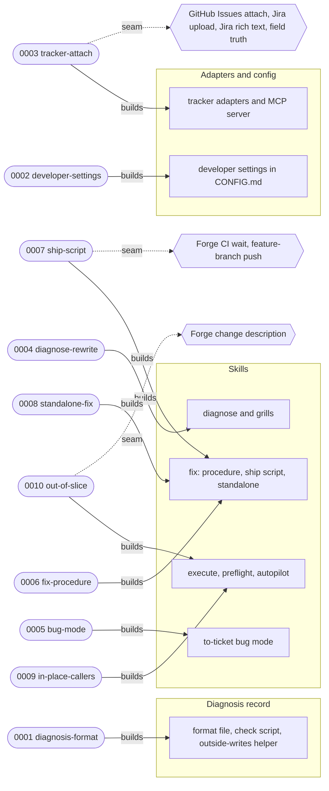
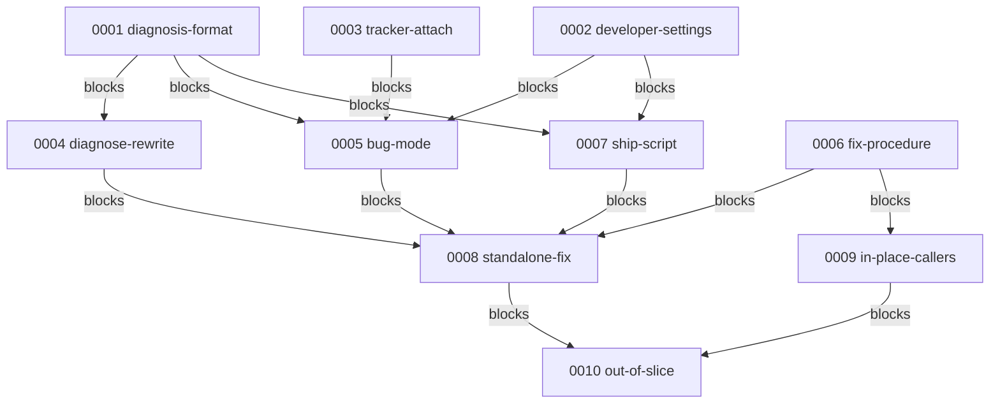

# Execution Plan — small lane

> Parent ticket: small-lane (no parent ticket; github-issues tracker)   Mode: cited
> Sources: [PRD](../PRD.md) · [SDD](../SDD.md) · [ADRs](../adr/)
> Branch (for /afk:execute): feat/feat-small-lane
> Last updated: 2026-10-27 (status column maintained by /afk:execute)
> Feature: in-progress   <!-- /afk:smoke-test stamps "complete (smoke green …)" iff a smoke gate exists -->
> Before /afk:execute: fast-forward the main checkout to origin/main (needs 442cfa6, #113) and run its `skills/afk/to-subtasks/scripts/validate_plan.py` on this folder to a clean exit; older copies reject the INV-022..026 ledgers
> Review policy: lean   <!-- lean | full — slice review-gate roster; semantics owned by skills/afk/review/SKILL.md "Gate policy". Seeded lean; flip to full by hand for the full roster on every slice; absent (older plans) reads full -->

## Solution map

Each subtask points at the part of the plugin it builds; dotted edges are the SDD §9b external seams.

Caption: the record and the adapters come first; the skills are built on them; removal (0011) and the harness sync (0012) follow everything.

Caption: the dependency order; 0011 is blocked by every implementation subtask and 0012 by everything.

## Seam register

| § | Seam (SDD §9b row) | Implemented by | Used by |
|---|--------------------|----------------|---------|
| 1 | "GitHub Issues attach" | 0003-tracker-attach | 0005-bug-mode |
| 2 | "Jira attachment upload" | 0003-tracker-attach | 0005-bug-mode |
| 3 | "Jira rich text" | 0003-tracker-attach | 0005-bug-mode |
| 4 | "Forge CI wait" | 0007-ship-script | 0008-standalone-fix |
| 5 | "Forge change description" | 0010-out-of-slice | — |
| 6 | "Feature-branch push" | 0007-ship-script | 0008-standalone-fix |
| 7 | "Field truth" | 0003-tracker-attach | 0005-bug-mode |
| 8 | §14 row "`/afk:to-ticket` bug mode, not through `publish_prd`" | 0005-bug-mode | 0008-standalone-fix |
| 9 | §14 row "`/afk:execute` fix points and limits" | 0009-in-place-callers | 0010-out-of-slice |

Rows 8–9 are §14 change seams a later subtask uses; every other §14 row is listed `implement:` in exactly the subtask that owns it.

## Progress tracker

| # | Subtask | Title | Status | Blocked by | Tiers | Seams |
|---|---------|-------|--------|------------|-------|-------|
| 1 | 0001-diagnosis-format | diagnosis format file, check script, outside-writes helper | done | — | static, unit, integration | — |
| 2 | 0002-developer-settings | developer settings K1–K5 move to CONFIG.md | done | — | static, unit, integration | — |
| 3 | 0003-tracker-attach | `tracker_attach`, Jira formatted text and refusals, registry check E | done | — | static, unit, integration | impl §1, §2, §3, §7 |
| 4 | 0004-diagnose-rewrite | diagnose never fixes; grills take a diagnosis and end with the size call | blocked(review_fail: round 14 left 4 open on D-38 - shipped format row overridden only by the plan ledger, plus 3 wording defects) | 0001-diagnosis-format | static, unit, integration | — |
| 5 | 0005-bug-mode | `/afk:to-ticket` bug and ad-hoc mode | done | 0001-diagnosis-format, 0002-developer-settings, 0003-tracker-attach | static, unit, integration | impl §8; use §1, §2, §3, §7 |
| 6 | 0006-fix-procedure | shared in-place fix procedure, lesson links | pending | — | static, integration | — |
| 7 | 0007-ship-script | ship script: open, proof, ready, land | pending | 0001-diagnosis-format, 0002-developer-settings | static, unit, integration | impl §4, §6 |
| 8 | 0008-standalone-fix | `/afk:fix` standalone and feature-branch fix | pending | 0004-diagnose-rewrite, 0005-bug-mode, 0006-fix-procedure, 0007-ship-script | static, integration | use §4, §6, §8 |
| 9 | 0009-in-place-callers | execute, preflight, autopilot read the procedure | pending | 0006-fix-procedure | static, unit, integration | impl §9 |
| 10 | 0010-out-of-slice | blocking and non-blocking defects outside the slice | pending | 0008-standalone-fix, 0009-in-place-callers | static, unit, integration | impl §5; use §9 |
| 11 | 0011-bug-removal-release | remove `/afk:bug`, one tracker writer, major release | pending | 0001..0010 (all implementation subtasks) | static, unit, integration | — |
| 12 | 0012-sync-harness | AGENTS.md harness sync + trace matrix | pending | every other subtask | static | — |
| 13 | 0013-config-contract | config reader keeps the developer-settings contract (D-7) | pending | 0002-developer-settings | static, unit, integration | use developer settings |

Status values: `pending` → `designing` → `developing` → `verifying` → `reviewing` → `done`,
or `blocked(<reason>)`. <!-- status set: lockstep copy — owned by /afk:execute (progress-tracker status column) -->
`/afk:execute` advances the row it is working and writes
the date in the header; everything else in PLAN.md is yours to edit.

## Feature smoke gate (minimal)

| # | Check | Command | Status |
|---|-------|---------|--------|
| 1 | compile | `bash hooks/plugin-source-gates.sh --range origin/main HEAD` (this repository declares no `verification.tiers`; the command is the plugin-source gate CI runs) | |
| 3 | regression | `afk-python -m pytest scripts/tests -q` and `bash hooks/tests/hook-smoke.sh`, on Windows and WSL (the suites CI runs) | |

Rows 2 (app-start), 4 (existing e2e suite) and 5 (existing api suite) are dropped: this repository has no build-gate kind, no `e2e/browser` tier and no `api` tier.

Last run: —
